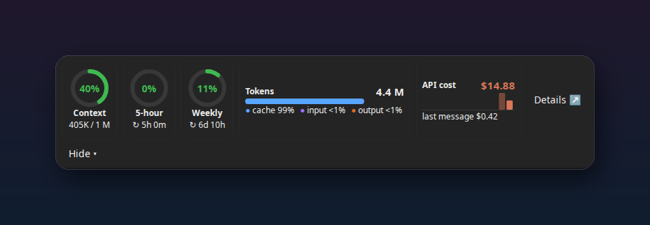
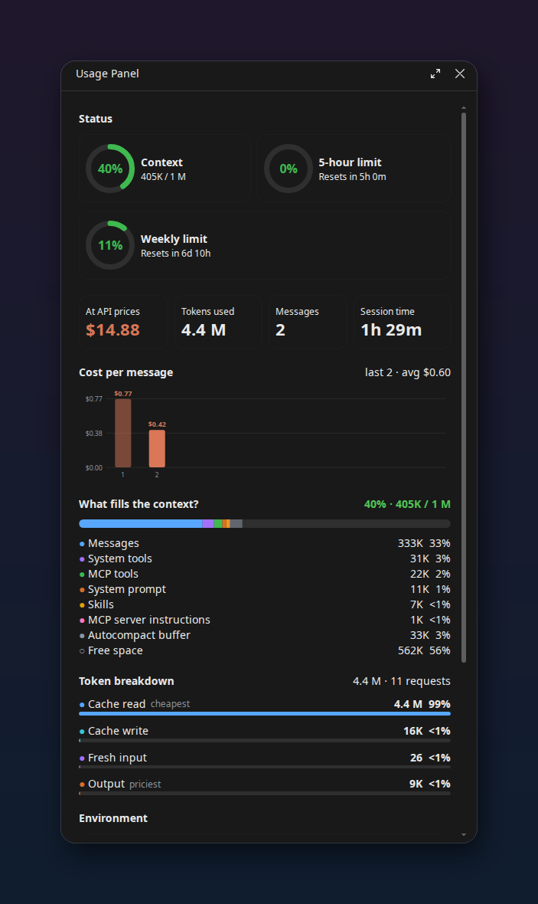
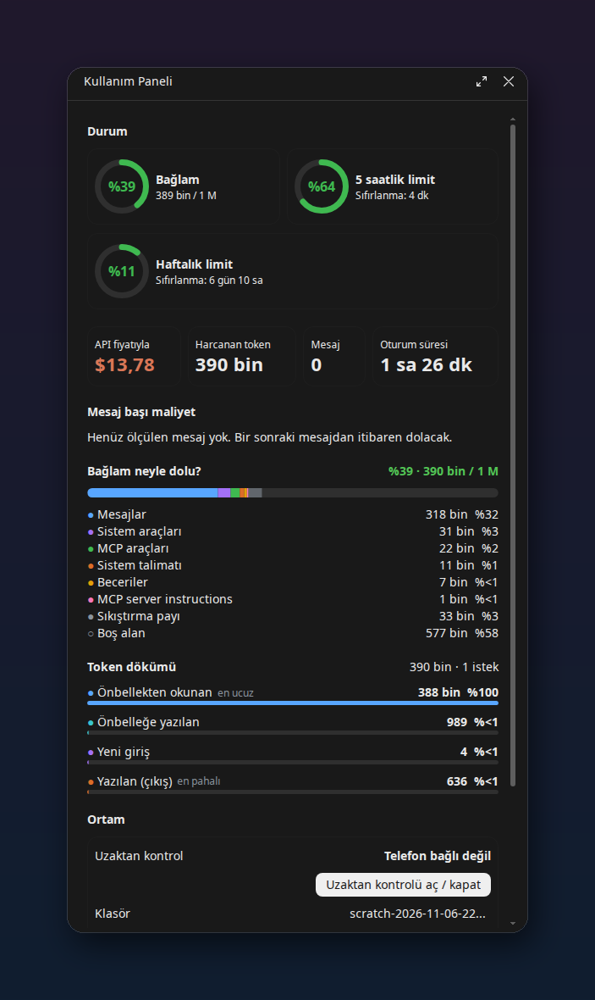

# Usage Strip for Claude Code

See where your session stands without leaving the chat: context fill, plan limits, tokens used and what the session would cost at API prices, drawn as clean visual cards right above the prompt. One click opens a detailed usage panel beside the conversation.

Built for the **Claude Code desktop app** (Code tab); it also draws in the terminal (with text bars), VS Code and mobile. **English and Turkish** built in.





## What it shows

**The strip (above the prompt)**

- **Context:** ring gauge with tokens used out of the window
- **5-hour and weekly limits:** ring gauges with time until reset
- **Tokens:** session total and a cache / input / output mix bar
- **API cost:** what the session would cost at API prices, with a per-message sparkline
- Rings turn **amber at 80%** and **red at 90%**
- **Details ↗** opens the panel, **Hide ▾** collapses the strip to a single "Show" line

**The panel (beside the chat), most looked-at first**

1. Status: context and plan limits, with reset times
2. Summary: API-price cost, tokens used, messages, session time
3. Cost per message: bar chart of your last 20 replies
4. What fills the context: system prompt, tools, MCP, messages, free space
5. Token breakdown: cache read, cache write, fresh input, output
6. Environment: Remote Control status and toggle, folder (long names end in `...`, click for the full path), model, git, connected screens, version

## Install

Requires Claude Code **2.1.287 or newer**.

At the prompt of a terminal session:

```
/plugin install usage-strip --marketplace baran-labs/claude-usage-strip
```

Answer `y` to add the marketplace, then pick a scope (user scope is the first option).

From a shell:

```bash
claude plugin install usage-strip --marketplace baran-labs/claude-usage-strip
```

In the desktop app, where `/plugin` does not run: click **+** next to the prompt box, then **Plugins**, **Add marketplace** with `baran-labs/claude-usage-strip`, then **Add plugin**. A mod installed at user scope from a terminal also loads in the desktop app.

## Usage

| Action | How |
| --- | --- |
| Hide / show the strip | **Hide ▾** and **Show ▴** buttons, or `/usage-strip` (`/kullanim` in Turkish) |
| Open the panel | **Details ↗** button, or `/usage-panel` (`/kullanim-panel`) |
| Close the panel | Esc or the × in its corner |

## Language

The `language` option is `auto` by default: Turkish when your system locale starts with `tr`, English otherwise. You can pick `auto`, `en` or `tr` on the options screen when you install, and change it later in `/config` in a terminal session.

## Good to know

- **Dollar amounts are API-price equivalents.** On a Pro or Max subscription nothing extra is charged; the figure shows what the same usage would cost on the API.
- **The token counter starts when the mod loads**, and counts every request, subagents included. The cost-per-message chart counts only replies to your own messages.
- **Remote Control toggle** runs Claude Code's own `/remote-control` command and shows its answer as a notification.

## Privacy

The mod makes **no network requests**, **reads and writes no files** and **runs no shell commands**. It only reads what Claude Code already knows about the session (usage, model, folder path, connected screens). Everything stays on your machine.

## Development

```bash
claude plugin validate .
claude plugin test .
```

The test suite (17 tests) covers both languages on every surface, edge cases (no limits, no cost, context not measured), hide/show, the folder name, the Remote Control button, the per-message cost history and the token counter.

## Credits

Adapted from **desktop-usage-strip** by Yash Thakker, part of [awesome-claude-code-mods](https://github.com/whyashthakker/awesome-claude-code-mods) (MIT).

## License

MIT, see [LICENSE](LICENSE).

---

## Türkçe

Sohbetten çıkmadan oturumunun durumunu gör: bağlam doluluğu, kullanım limitleri, harcanan token ve oturumun API fiyatlarıyla karşılığı, mesaj kutusunun hemen üstünde görsel kartlarla. Tek tıkla sohbetin yanına ayrıntılı bir kullanım paneli açılır.




**Kurulum:** Yukarıdaki *Install* bölümündeki komutları kullan. Masaüstü uygulamasında: mesaj kutusunun yanındaki **+**, sonra **Plugins**, **Add marketplace** ile `baran-labs/claude-usage-strip`, sonra **Add plugin**.

**Kullanım:**

- **Gizle ▾ / Göster ▴** düğmeleri şeridi daraltır ve açar (`/kullanim` komutu da aynı işi yapar).
- **Ayrıntılar ↗** ya da `/kullanim-panel` paneli açar, Esc kapatır.
- Halkalar %80'de sarıya, %90'da kırmızıya döner.

**Dil:** Varsayılan `auto`. Sistem dilin `tr` ile başlıyorsa Türkçe, değilse İngilizce. Kurulumdaki ayar ekranında `tr` ya da `en` seçebilir, sonradan terminalde `/config` ile değiştirebilirsin.

**Bilmen gerekenler:**

- Dolar tutarları API fiyatlarıyla karşılıktır, abonelikte ayrıca ödenmez.
- Token sayacı mod yüklendiğinde başlar.
- Mod internete bağlanmaz, dosyalara dokunmaz, komut çalıştırmaz.
