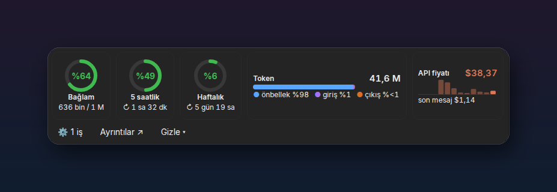

# Usage Strip for Claude Code

See where your session stands without leaving the chat: context fill, plan limits, tokens used and what the session would cost at API prices, drawn as clean visual cards right above the prompt. One click opens a tabbed panel beside the conversation whose first page is a one-screen dashboard: where your limits and context are heading, cost per message, session stats, background jobs and the latest outputs.

Built for the **Claude Code desktop app** (Code tab); it also draws in the terminal (with text bars), VS Code and mobile. **English and Turkish** built in.


## What it shows

**The strip (above the prompt)**

- **Context:** ring gauge with tokens used out of the window
- **5-hour and weekly limits:** ring gauges with time until reset
- **Tokens:** session total and a cache / input / output mix bar
- **API cost:** what the session would cost at API prices, with a per-message sparkline
- Rings turn **amber at 80%** and **red at 90%**
- **⚙ 2 jobs** appears while something runs in the background and opens that tab
- **Details ↗** opens the panel, **Hide ▾** collapses the strip to a single "Show" line

**The panel (beside the chat), in tabs**

- **Overview:** one screen, no scrolling, nothing the strip already shows:
  - *Limit forecast:* at your pace so far, where each window ends up by its reset ("51% → ~73% at reset"), with a verdict: plenty of room, getting close, or "runs out in ~1h 5m"
  - *Context:* what fills it, where auto-compact starts, growth per message and how many messages are left before it compacts
  - *Cost:* cost per message with the average line, last hour, average and priciest message
  - *Session:* replies, average and longest reply time, tool calls and the most used tools
  - *Background* and *Latest outputs*, side by side
- **Cost:** cost per message chart and the token breakdown (cache read, cache write, fresh input, output)
- **Context:** every category that fills the context window
- **Background:** running shell commands, subagents, monitors and workflows; recent subagents; scheduled tasks (cron, `/loop`)
- **Outputs:** files Claude wrote or edited this session, and finished background jobs with their status, summary, a subagent's report and the output file path
- **Environment:** Remote Control status and toggle, folder (long names end in `...`, click for the full path), model, git, connected screens, version

## Install

Requires Claude Code **2.1.287 or newer**.

At the prompt of a terminal session:

```
/plugin install usage-strip --marketplace baran-labs/claude-usage-strip
```

Answer `y` to add the marketplace, then pick a scope (user scope is the first option).

From a shell:

```bash
claude plugin install usage-strip --marketplace baran-labs/claude-usage-strip
```

In the desktop app, where `/plugin` does not run: click **+** next to the prompt box, then **Plugins**, **Add marketplace** with `baran-labs/claude-usage-strip`, then **Add plugin**. A mod installed at user scope from a terminal also loads in the desktop app.

## Usage

| Action | How |
| --- | --- |
| Hide / show the strip | **Hide ▾** and **Show ▴** buttons, or `/usage-strip` (`/kullanim` in Turkish) |
| Open the panel | **Details ↗** button, or `/usage-panel` (`/kullanim-panel`) |
| Close the panel | Esc or the × in its corner |

## Language

The `language` option is `auto` by default: Turkish when your system locale starts with `tr`, English otherwise. You can pick `auto`, `en` or `tr` on the options screen when you install, and change it later in `/config` in a terminal session.

## Good to know

- **Dollar amounts are API-price equivalents.** On a Pro or Max subscription nothing extra is charged; the figure shows what the same usage would cost on the API.
- **Counters start when the mod loads:** tokens, reply times and tool calls count every request from then on, subagents included. The cost-per-message chart counts only replies to your own messages.
- **Forecasts are estimates.** Limit forecasts use your average pace since the window opened and wait until 5% of it has passed; context forecasts need a few replies. Both refresh after every reply.
- **The Background list refreshes at the end of every reply**; subagents show live.
- **Remote Control toggle** runs Claude Code's own `/remote-control` command and shows its answer as a notification.

## Privacy

The mod makes **no network requests**, **reads and writes no files** and **runs no shell commands**. It only reads what Claude Code already knows about the session: usage, model, folder path, connected screens, background job notifications, and the file paths in Claude's own Write and Edit calls. Everything stays on your machine.

## Development

```bash
claude plugin validate .
claude plugin test .
```

The test suite (23 tests) covers both languages on every surface, a language that settles mid-load, edge cases (no limits, no cost, context not measured), hide/show, every tab, the limit and context forecasts, background jobs and their notifications, file tracking, session stats, the folder name, the Remote Control button, the per-message cost history and the token counter.

## Credits

Adapted from **desktop-usage-strip** by Yash Thakker, part of [awesome-claude-code-mods](https://github.com/whyashthakker/awesome-claude-code-mods) (MIT).

## License

MIT, see [LICENSE](LICENSE).

---

## Türkçe

Sohbetten çıkmadan oturumunun durumunu gör: bağlam doluluğu, kullanım limitleri, harcanan token ve oturumun API fiyatlarıyla karşılığı, mesaj kutusunun hemen üstünde görsel kartlarla. Tek tıkla sohbetin yanına sekmeli bir panel açılır. İlk sekmesi tek ekranlık bir pano: limitlerin ve bağlamın nereye gittiği (tahmin), mesaj başı maliyet, oturum istatistikleri, arka plan işleri ve son çıktılar.




**Kurulum:** Yukarıdaki *Install* bölümündeki komutları kullan. Masaüstü uygulamasında: mesaj kutusunun yanındaki **+**, sonra **Plugins**, **Add marketplace** ile `baran-labs/claude-usage-strip`, sonra **Add plugin**.

**Kullanım:**

- **Gizle ▾ / Göster ▴** düğmeleri şeridi daraltır ve açar (`/kullanim` komutu da aynı işi yapar).
- **Ayrıntılar ↗** ya da `/kullanim-panel` paneli açar, Esc kapatır.
- Halkalar %80'de sarıya, %90'da kırmızıya döner.
- Arka planda iş çalışırken şeritte **⚙ 2 iş** düğmesi çıkar, tıklayınca Arka plan sekmesi açılır.
- Panel sekmeleri: **Genel** (tahminler ve özet), **Maliyet**, **Bağlam**, **Arka plan**, **Çıktılar** (değişen dosyalar ve biten işler), **Ortam**.

**Dil:** Varsayılan `auto`. Sistem dilin `tr` ile başlıyorsa Türkçe, değilse İngilizce. Kurulumdaki ayar ekranında `tr` ya da `en` seçebilir, sonradan terminalde `/config` ile değiştirebilirsin.

**Bilmen gerekenler:**

- Dolar tutarları API fiyatlarıyla karşılıktır, abonelikte ayrıca ödenmez.
- Sayaçlar (token, yanıt süresi, araç kullanımı) mod yüklendiğinde başlar.
- Tahminler yaklaşıktır ve her yanıtın sonunda yenilenir.
- Mod internete bağlanmaz, dosyalara dokunmaz, komut çalıştırmaz.
